# MyTaskTracker

MyTaskTracker is a task-management platform built with two Angular 18 single-page applications and five ASP.NET Core 8 microservices. It demonstrates a complete delivery path: local Docker Compose development, Azure infrastructure provisioned with Terraform, Kubernetes packaging with Helm, and GitOps delivery through Argo CD.

## Architecture

| Component | Responsibility |
| --- | --- |
| CustomerApp | Angular application for everyday task, project, comment, and notification work. |
| AdminPortal | Angular application for administration, users, projects, tasks, and comments. |
| AuthService | OAuth authorization server, registration, token verification, and revocation. |
| Task, Project, Comment, Notification services | Protected business APIs; each owns its application data. |
| MariaDB | Persistent relational storage with one database per backend service. |
| Valkey | Server-side OAuth requests, authorization codes, opaque access-token state, refresh sessions, and lockout state. |

The architecture below shows how the two browser applications use AuthService and the protected resource APIs, with MariaDB databases owned by individual services and Valkey holding OAuth state.

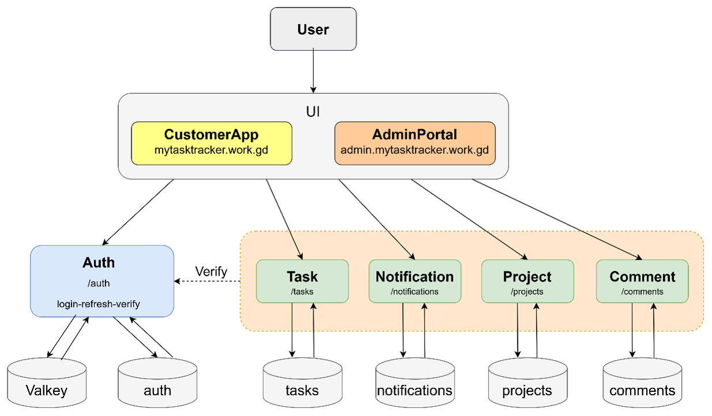

## Authentication

The application uses OAuth 2.0 Authorization Code with PKCE for public SPAs. Password grant and JWT access tokens are not used.

1. A frontend creates `state`, a PKCE verifier, and an S256 challenge, then redirects to `GET /connect/authorize`.
2. AuthService stores the authorization transaction in Valkey and serves its login page.
3. After a successful login, AuthService stores a short-lived, one-time authorization code and redirects to the registered SPA callback with `code` and `state`.
4. The SPA exchanges the code and verifier through `POST /connect/token`.
5. AuthService returns random opaque access and refresh tokens; server-side token hashes and session metadata are held in Valkey.
6. Resource services send the bearer token to `GET /verify` on AuthService before serving protected APIs.
7. A `401` triggers refresh-token rotation and a retry. Logout uses `POST /connect/revocation` to remove server-side token state.

See the detailed diagram in [reports/Figures/README.md](reports/Figures/README.md).

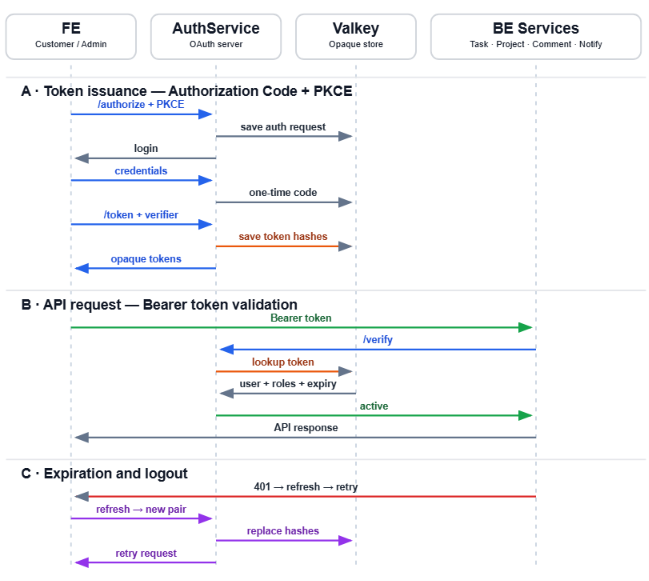

## Application interfaces

CustomerApp supports everyday task and project work. Its screenshot shows the authenticated customer-facing interface and must not contain credentials, access tokens, or unrelated personal information.

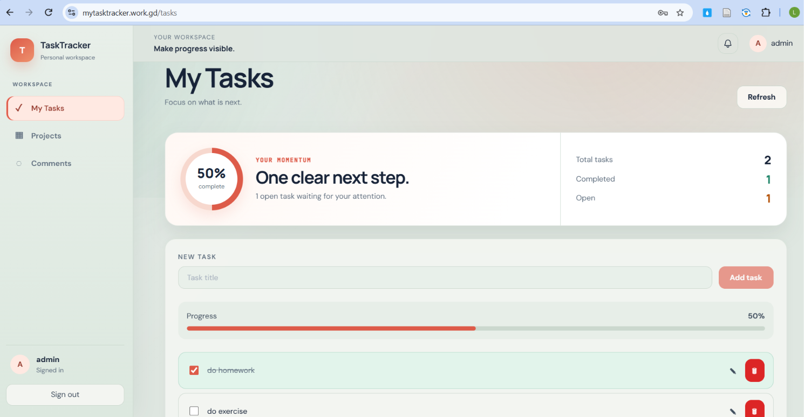

AdminPortal provides the administration view. Its screenshot shows an authenticated administration interface and must not contain credentials, access tokens, or unrelated personal information.

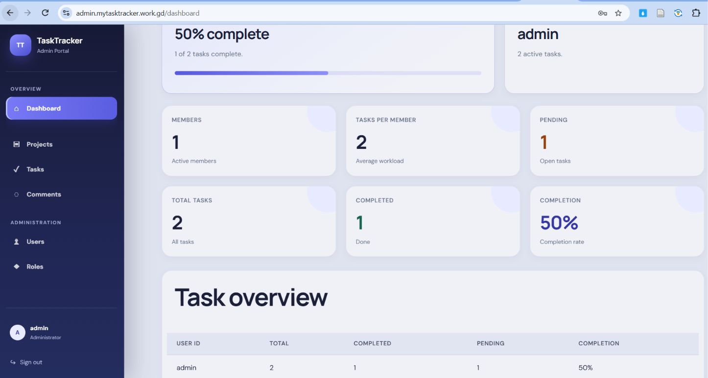

## Repository layout

```text
MyTaskTracker/
├── app/
│   ├── Backend/
│   │   ├── Tracker.AuthService/
│   │   ├── Tracker.TaskService/
│   │   ├── Tracker.ProjectService/
│   │   ├── Tracker.CommentService/
│   │   ├── Tracker.NotificationService/
│   │   └── Tests/
│   ├── Frontend/
│   │   ├── CustomerApp/
│   │   └── AdminPortal/
│   ├── infra/mariadb/init/
│   ├── docker-compose.yml
│   └── .env.example
├── deploy/
│   ├── root-app.yaml
│   ├── argocd-apps/
│   ├── charts/microservice/
│   ├── environments/dev/
│   ├── values/base/
│   ├── observability/
│   ├── security/
│   └── tls-config/
├── infrastructure/
│   ├── environments/dev/{persistent,workloads}/
│   ├── environments/{staging,prod}/
│   ├── modules/
│   └── scripts/
├── reports/
└── .github/workflows/
```

## Local development

### Prerequisites

- .NET SDK 8
- Node.js 22 and npm
- Docker Desktop with Docker Compose
- Terraform and Azure CLI only when working with cloud infrastructure

### Start the full stack

```powershell
Push-Location app
docker compose up -d
Pop-Location
```

This is the normal local startup command. On a fresh clone, create `app/.env` once from `app/.env.example` before the first run. Use `docker compose up -d --build` only after changing a Dockerfile, a dependency, or application code that must be rebuilt into an image.

Docker Compose starts MariaDB 11.4, Valkey, one migration container for each backend service, the five APIs, and both frontends. Database initialization creates the service databases; EF Core migrations create application tables.

| Local endpoint | Service |
| --- | --- |
| `http://localhost:4200` | CustomerApp |
| `http://localhost:4300` | AdminPortal |
| `http://localhost:5001` | AuthService |
| `http://localhost:5002` | TaskService |
| `http://localhost:5003` | NotificationService |
| `http://localhost:5004` | ProjectService |
| `http://localhost:5005` | CommentService |

For host debugging, start only the dependencies:

```powershell
Push-Location app
docker compose up -d mariadb valkey
Pop-Location
```

Copy values from `app/.env.example`; never commit `app/.env`, user secrets, connection strings, or Kubernetes credentials.

## Build and test

Run backend tests per service, for example:

```powershell
dotnet test app/Backend/Tests/Tracker.AuthService.Tests/Tracker.AuthService.Tests.csproj
```

Build either frontend for the Azure dev configuration:

```powershell
Push-Location app/Frontend/CustomerApp
npm ci
npm.cmd run build:dev
Pop-Location
```

Use the equivalent path for `AdminPortal`. GitHub Actions detects changed applications, runs Gitleaks, backend tests with coverage, frontend build/tests, Helm validation, and then builds/pushes changed images from `main`. A subsequent GitOps commit updates image tags consumed by Argo CD.

## Cloud and infrastructure as code

Terraform defines Azure foundations in `infrastructure/`:

- Dev is split into `persistent` and `workloads` roots with separate remote state.
- Reusable modules provision ACR, AKS, networking, Key Vault, identities, and storage.
- Workload Identity is used for Azure access instead of static cloud credentials.

Terraform defines the desired infrastructure, not its current health. Verify live Azure and AKS state with Terraform plans, Azure, Argo CD, `kubectl`, logs, health checks, and deployment image tags.

The diagram shows the Azure dev foundation around AKS: GitHub Actions and Argo CD deliver Helm-managed workloads, ACR supplies container images, and DNS, the load balancer, ingress, and cert-manager provide public routing and TLS. The application namespace contains the services, MariaDB, and Valkey; Key Vault supplies secrets, while separate Blob Storage locations hold database backups and Loki data. Prometheus, Grafana Alloy, Grafana, and Loki form the monitoring stack. Terraform state is kept separately from application and observability data.


## CI/CD and GitOps

The **application CI/CD** workflow is separate from Terraform infrastructure CI. Both use GitHub Actions and Azure OIDC rather than a long-lived Azure client secret.

### Application CI/CD

`ci.yml` runs on pull requests and pushes to `main`; a manual dispatch can force all services to build. `dorny/paths-filter` identifies changed backend services, frontend applications, and Helm files so unrelated services are skipped.

| Stage | Pull request | Push to `main` |
| --- | --- | --- |
| Security | Gitleaks scans the source history/diff. | The same secret scan runs. |
| Backend | Changed services restore, build, test, and publish TRX/Cobertura artifacts. | The same checks run; successful services also publish build artifacts. |
| Frontend | Changed Angular applications run `npm ci`, `build:dev`, and Jest. | The same checks run; the flattened `dist` output is uploaded. |
| Helm | Deploy changes run Valkey rendering, chart lint, and AuthService/CustomerApp template rendering with dev values. | The same validation runs when deploy files change. |
| Image and GitOps release | No registry or cluster mutation. | Changed services build cached `linux/arm64` images, authenticate to ACR through OIDC, push a Git-SHA tag, then update the matching `deploy/values/base/*.yaml` tag in a `[skip ci]` commit. |

`ci-gate` aggregates required job results; branch protection must be configured in GitHub to require that gate. The GitOps update is deliberately separate from the image build, so the deployed version is traceable as an image SHA in the repository.

The diagram summarizes this application release path: change detection gates validation and image builds, a successful release publishes images and updates Git-tracked tags, and Argo CD reconciles those desired versions into AKS.

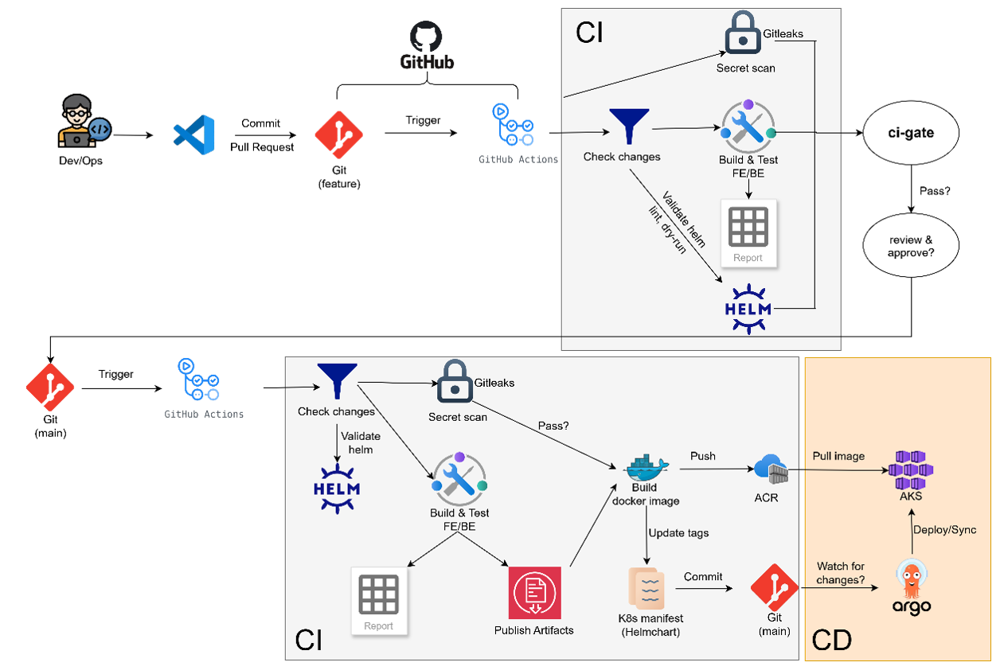

### Infrastructure CI/CD

`infra-ci.yml` handles Terraform only when `infrastructure/environments/dev/persistent/**`, `workloads/**`, or a reusable module changes. It maintains two non-cancelling concurrency groups, one for each state, and uses OIDC to initialize the Azure Blob backend with Azure AD authentication.

1. **Pull request:** Checkov, `terraform init`, `validate`, and `plan` run for changed stacks. The workflow posts the plan/defer status back to the pull request.
2. **Persistent state:** on `main`, the persistent foundation applies first. It owns long-lived resources such as ACR, DNS, public IP, and storage.
3. **Workloads state:** a workloads-only change can apply on `main` in two phases: AKS first, then the complete state. If a pull request changes both state roots, the workloads plan is marked advisory because persistent remote-state outputs have not been written yet.
4. **Combined change safety:** after persistent applies, CI creates a fresh workloads plan from `main`. A reviewer must dispatch `apply-workloads-plan` with that run ID; the workflow refuses a stale or source-mismatched plan.
5. **Terraform-to-GitOps handoff:** successful workloads operations regenerate Key Vault, cert-manager, backup, and Loki values in `deploy/environments/dev/`, then commit them with `[skip ci]` only when the values changed.
6. **Destroy protection:** a manual `destroy` first creates a one-off Job from `tracker-db-backup`, waits up to ten minutes for completion, and only then permits `terraform destroy`.

### GitOps delivery

`deploy/root-app.yaml` is the Argo CD app-of-apps entry point. Its ApplicationSet reconciles the shared Helm chart, service values, ingress, TLS, MariaDB, Valkey, observability, NetworkPolicies, migration Jobs, and database backup into AKS. GitHub Actions produces artifacts and commits desired state; Argo CD is the in-cluster agent that pulls Git and reconciles that state. Automated sync, self-healing, and pruning make Git the intended source of truth, but live health must still be verified through Argo CD, `kubectl`, metrics, and logs.

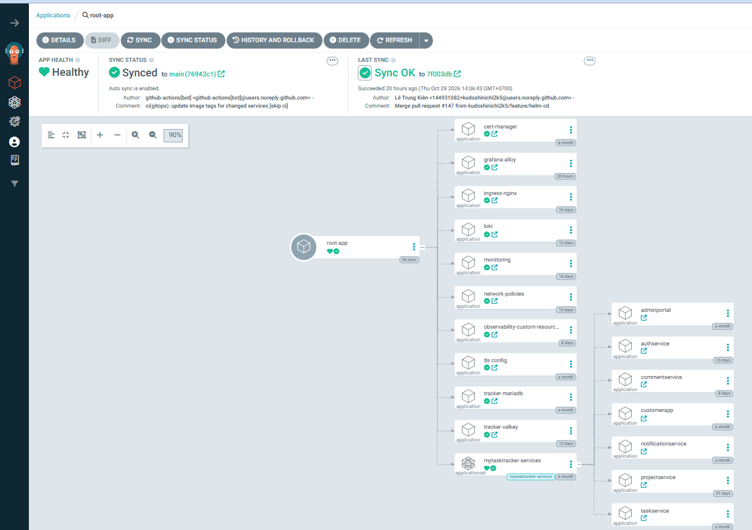

## Observability

Prometheus collects metrics, Grafana Alloy collects logs, Loki stores and queries logs, and Grafana provides dashboards and Explore. The diagrams below describe the configured telemetry path; screenshots are point-in-time evidence and should be refreshed after material environment changes.

### Monitoring architecture: components and data sources

This is a **component map**: it explains what the monitoring services do and how their data sources relate. It is not a sequence diagram.

- **Metrics:** Prometheus stores and serves metrics. It discovers application `ServiceMonitor` resources when enabled, as well as NGINX Ingress and Kubernetes/node metrics.
- **Logs:** Grafana Alloy is the cluster log collector; Loki stores and serves logs for LogQL queries.
- **Visualization:** Grafana connects to Prometheus and Loki as separate data sources for dashboards and Explore.
- **Persistence:** Loki's long-term object storage is separate from MariaDB backup storage.

The diagram below shows these components and their data-source relationships at a glance.

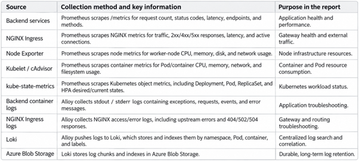

### Telemetry flow: collection, storage, and investigation

This is the **end-to-end movement view**: it shows how metrics and logs are collected, stored, and queried. The two paths remain separate until Grafana is used to investigate them.

- **Metrics path:** Prometheus scrapes application `/metrics` endpoints, NGINX Ingress, node exporter, kubelet/cAdvisor, and kube-state-metrics. Grafana queries Prometheus for resource usage, request rate, latency, and HTTP-status trends.
- **Logs path:** Grafana Alloy runs as a DaemonSet, discovers local pods, reads container stdout/stderr and NGINX Ingress access logs, adds Kubernetes labels such as namespace, pod, and container, then sends logs to the Loki Gateway.
- **Storage and investigation:** Loki stores searchable log data and persists long-term data to Blob Storage. Grafana queries Loki with LogQL. To investigate an incident, identify a symptom in metrics, then use the same time range and workload labels to find related application or ingress logs.

The workflow diagram below traces these two collection paths, their storage, and how Grafana is used to investigate the resulting telemetry.

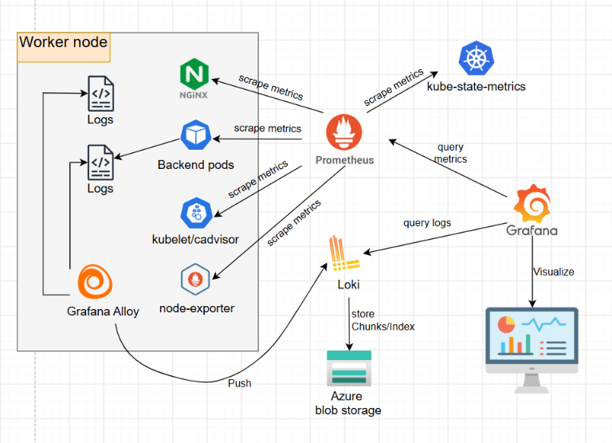

### Measurements and investigation

The evidence below follows the investigation sequence used in the report: first identify a resource, traffic, or HTTP-status symptom in Grafana; then narrow the same time range and namespace in Loki to inspect application or ingress logs. The Prometheus image shows node-memory data.

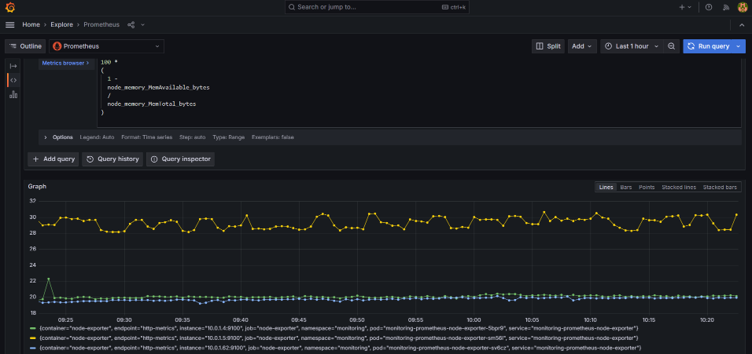

The NGINX dashboard shows request rate and HTTP-status behavior.

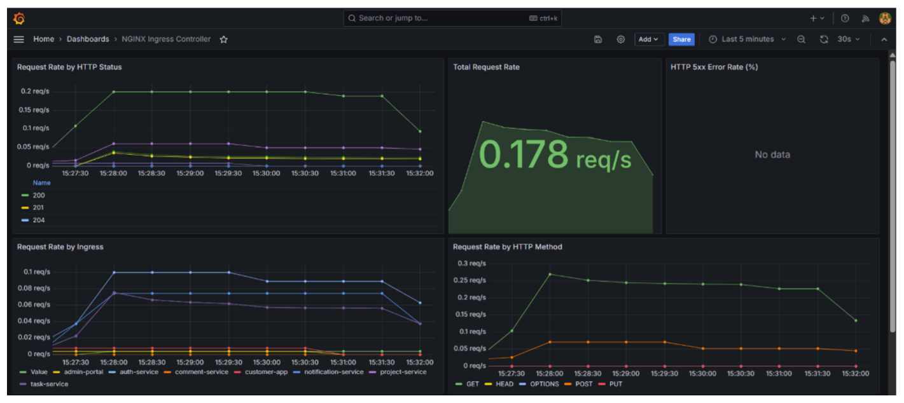

This Explore screenshot shows application logs queried from Loki.

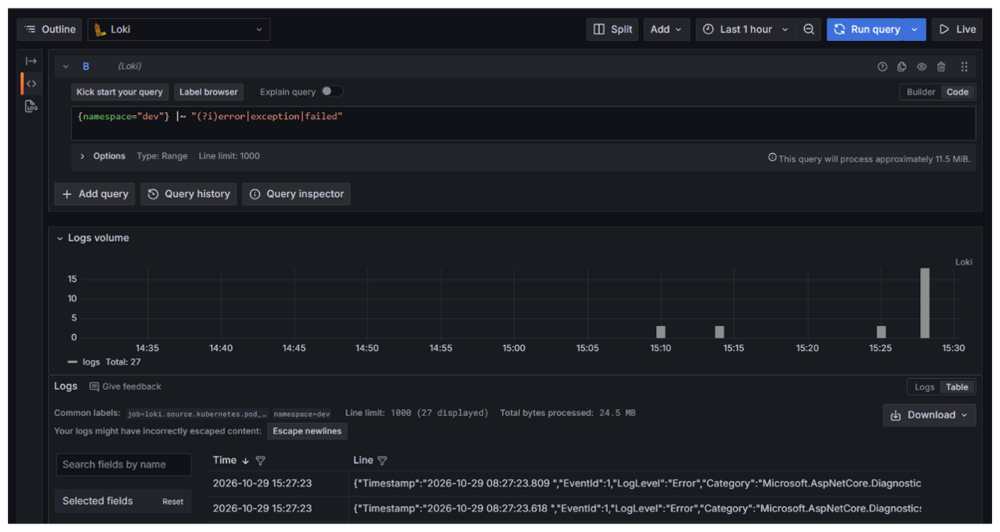

This Explore screenshot shows NGINX Ingress access logs queried from Loki.

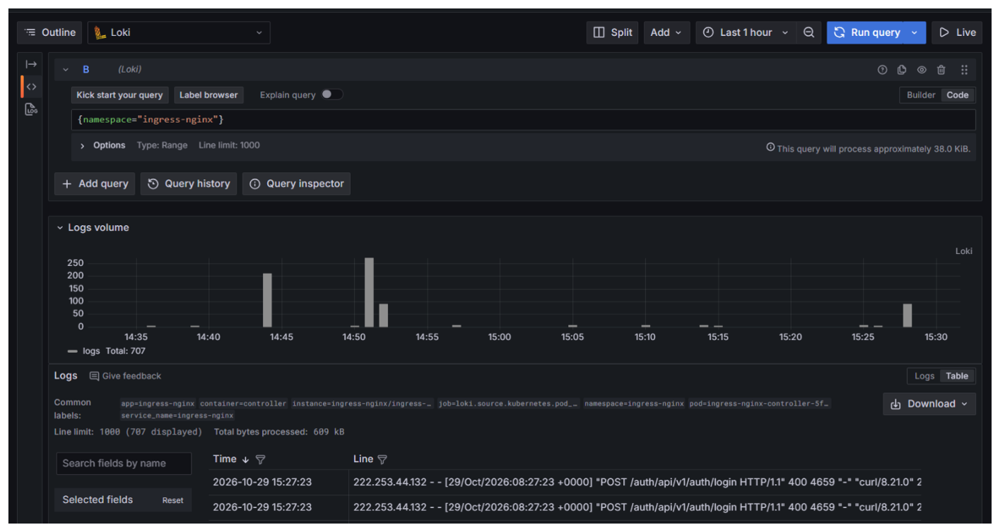

`IngressHigh5xxRate` is declared as a warning rule when the NGINX Ingress 5xx ratio exceeds 5% for one minute. Alertmanager is disabled in the dev values, so the rule can be evaluated but requires Alertmanager configuration before it can notify a channel. For an acceptance check, generate controlled success and failure requests in staging, compare the Grafana request/status metrics with the same timestamp in Loki, and record the result.

## Reports and screenshots

The current internship report is [reports/LeTrungKien_Internship_Report.pdf](reports/LeTrungKien_Internship_Report.pdf). The exact filename, report location, and recommended content for every screenshot or diagram are maintained in [reports/Figures/README.md](reports/Figures/README.md).

## Contribution

Keep changes focused, do not commit secrets, and use Conventional Commit messages such as `feat(auth): add PKCE callback handling` or `docs(report): add monitoring figure`. Review the relevant service, Helm values, and deployment configuration together when a change crosses those boundaries.
