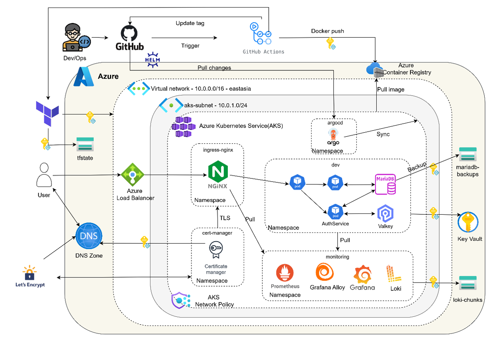

# MyTaskTracker Infrastructure

This directory contains the Azure infrastructure-as-code for MyTaskTracker. Terraform provisions Azure foundations and the AKS platform; Kubernetes application definitions and their GitOps wiring live in the sibling `deploy/` directory.

## Architecture At A Glance

The `dev` environment is split into two Terraform roots with separate Azure Blob state files. The persistent root owns resources that should survive replacement of the AKS workloads. The workloads root reads the persistent outputs through `terraform_remote_state` and creates the cluster and environment-specific resources.

### Reading the Azure and AKS architecture

The diagram is a logical view of the dev platform and its delivery and operations paths:

- **Provisioning and state:** Terraform and GitHub Actions manage Azure resources and keep Terraform state in its own storage location. This state is separate from the MariaDB backup and Loki data containers.
- **Network boundary and ingress:** The VNet contains the AKS and database subnets. Public DNS points users to the Azure load balancer and NGINX Ingress; cert-manager obtains TLS certificates through the DNS zone. AKS NetworkPolicy resources constrain pod traffic.
- **Build and deployment:** GitHub Actions publishes application images to ACR. Argo CD runs in its own namespace, follows the Git-managed Helm configuration, and reconciles the desired workloads in AKS; the cluster pulls the referenced images from ACR.
- **Application data and secrets:** The `dev` namespace contains the application services, MariaDB, and Valkey. Key Vault supplies secrets to workloads. MariaDB backup data is stored separately from Loki's log chunks.
- **Monitoring and recovery:** Prometheus collects metrics, Alloy ships logs to Loki, and Grafana presents both data sources. Database backups and the Loki chunks container provide distinct recovery/retention paths.

This is an architecture diagram, not a live health check or a guarantee that every resource shown is currently deployed. Use Terraform state and plans, Argo CD, Azure, and Kubernetes to verify the current environment.



### Azure layers

| Layer | Resources and purpose |
| --- | --- |
| Persistent foundation | Creates the app and shared Resource Groups, ACR, private MariaDB backup container and dedicated private Loki storage account/container, storage lifecycle policy, GitHub Actions and Terraform CI user-assigned identities, and their scoped role assignments. |
| Public networking foundation | Creates the Azure DNS zone and a static Standard Public IP in the shared Resource Group. The DNS zone name servers are output for registrar delegation. |
| AKS workloads | Creates the VNet, AKS and database subnets, database NSG, AKS cluster, and the AKS-to-ACR `AcrPull` assignment. Current dev address ranges are `10.0.0.0/16`, `10.0.1.0/24` (AKS), and `10.0.2.0/24` (DB subnet). |
| Application platform | Creates a Key Vault, per-backend workload identities and Key Vault access, database passwords and connection-string secrets, Kubernetes namespace/initialization Secret, backup identity/storage permission, and cert-manager identity with DNS Zone Contributor scoped to the project's DNS zone. |
| Kubernetes delivery | `deploy/` contains Argo CD Application definitions, Helm charts, base service values, and dev-specific values for services and platform components. This is the delivery layer, not a Terraform module. |

### Network and identity flow

- AKS uses a system-assigned cluster identity and a separate kubelet identity. The kubelet identity receives `AcrPull` on the ACR; the cluster identity receives `Network Contributor` on the shared Resource Group so the cluster can use the static public IP.
- AKS OIDC issuer and workload identity are enabled. Each backend service, the backup job, Loki, and cert-manager have a user-assigned identity federated to the matching Kubernetes service account.
- Backend identities receive `Key Vault Secrets User` on the workload Key Vault. The backup identity receives `Storage Blob Data Contributor` on the backup storage account. The cert-manager identity receives `DNS Zone Contributor` only on the configured DNS zone.
- The Loki identity is created in the workloads state using the AKS OIDC issuer and receives `Storage Blob Data Contributor` only on the Loki chunks container. Loki storage is separate from MariaDB backups; its client ID is output by the workloads root for Kubernetes/GitOps configuration.
- GitHub authentication uses Azure federated credentials rather than a stored client secret. The persistent stack discovers GitHub owner/repository IDs through the GitHub API; an optional `github_token` can be supplied through a secure environment variable to avoid unauthenticated API rate limits.
- The Kubernetes provider in the workloads root gets its connection data from the AKS module outputs. Those outputs are marked sensitive because they contain cluster credentials.

## Repository Layout

```text
infrastructure/
|-- README.md
|-- ai_progress_tracker.md
|-- .gitignore
|-- environments/
|   |-- dev/
|   |   |-- persistent/       # Long-lived Azure foundation; own remote state
|   |   |-- workloads/         # VNet, AKS, Key Vault and workload resources; own state
|   |-- staging/               # Environment-specific Terraform root and values
|   `-- prod/                  # Environment-specific Terraform root and values
|-- modules/
|   |-- acr/                   # Azure Container Registry
|   |-- aks/                   # AKS cluster and connection/identity outputs
|   |-- identity/              # User-assigned identity and federated credentials
|   |-- keyvault/              # RBAC-enabled Azure Key Vault
|   |-- networking/            # VNet, subnets and database NSG
|   `-- storage/               # Reusable storage account and backup container
`-- scripts/
	`-- dr-restore-job.yaml    # Kubernetes disaster-recovery restore drill Job

deploy/
|-- root-app.yaml              # Argo CD root application
|-- argocd-apps/               # Argo CD apps/ApplicationSet for platform and services
|-- charts/microservice/       # Reusable microservice Helm chart
|-- environments/dev/          # Dev Helm values for platform and applications
|-- tls-config/                # Helm chart for issuer and wildcard certificate
`-- values/base/               # Shared service values
```

The `staging/` and `prod/` directories currently use the earlier single-root layout (`main.tf`, `variables.tf`, `terraform.tfvars`, backend and provider configuration). The split `persistent/` + `workloads/` layout described above is the current dev design; do not assume the other environments have the same state boundary or resource set until they are migrated.

### Terraform module contracts

| Module | Responsibility | Important outputs |
| --- | --- | --- |
| `modules/acr` | Creates an Azure Container Registry. | Registry resource ID and login server. |
| `modules/aks` | Creates an AKS cluster, node pool, networking profile, OIDC/workload identity, and Key Vault Secrets Provider integration. | Cluster ID, sensitive Kubernetes connection values, kubelet identity object ID, cluster identity principal ID, OIDC issuer URL. |
| `modules/identity` | Creates a user-assigned identity and either GitHub federated credentials or an AKS service-account federated credential. | Client ID, principal ID, identity resource ID. |
| `modules/keyvault` | Creates an RBAC-enabled Azure Key Vault with soft delete and purge protection. | Vault ID and URI. |
| `modules/networking` | Creates the VNet, AKS and DB subnets, DB NSG, and subnet association. | VNet ID and subnet IDs. |
| `modules/storage` | Reusable storage account and private backup-container resources. | Storage account ID/name and container name. The current dev persistent stack declares its backup storage inline rather than calling this module. |

## Terraform State And Dependencies

The dev stacks use distinct keys in the existing Azure Blob backend (`TaskTrackerRG` / `tfstate4459` / `tfstate`):

| Root | State key | Depends on |
| --- | --- | --- |
| `environments/dev/persistent` | `dev-persistent.terraform.tfstate` | The pre-existing remote state Storage Account and container. |
| `environments/dev/workloads` | `dev-workloads.terraform.tfstate` | The persistent state, including Resource Group names/locations, ACR ID, CI identity principal ID, backup and Loki storage details, Loki container resource ID, DNS zone ID/name, and subscription ID. |

Apply the persistent root before workloads. Workloads cannot resolve its remote-state outputs until the persistent state exists and contains those outputs. Keep state files separate; do not point both roots at the same backend key. Backend configuration belongs in `backend.tf`, not `terraform.tfvars`, because Terraform initializes the backend before loading input variables.

### Terraform workflow for changes to both stacks

The infrastructure workflow uses separate non-cancelling concurrency groups for the persistent and workloads state files. Changes to shared Terraform modules count as changes to both roots. PRs run Checkov for each changed root. Each root has a Checkov baseline for findings that existed when enforcement was introduced; scans still fail for findings outside that baseline. Review and remediate baseline findings incrementally, and do not regenerate a baseline automatically.

When one root changes, the existing post-merge apply behavior is unchanged. Note that the current workflow runs a PR plan for review, then runs `terraform apply` after merge; it does not save and apply the exact binary plan created by the PR.

When a PR changes both roots, the workloads PR plan is best-effort and explicitly marked deferred; it is never applied. Persistent applies first after merge. Only if that succeeds does CI run a fresh workloads plan from `main`. Review the plan in the Actions run, then manually dispatch `Infrastructure CI/CD` on `main` with action `apply-workloads-plan` and that run's ID. CI checks the plan still matches the current Terraform source before applying. A failed persistent apply prevents the workloads plan.

The post-merge plan is stored in the existing private Azure Blob state container because Terraform plans can contain sensitive values and this repository is public. The current Terraform CI identity already has `Storage Blob Data Contributor` on that storage account; the workflow does not add or broaden Azure permissions. No GitHub Environment is used, so the existing OIDC subject is unchanged. Configure `infra-gate` as a required check in branch protection; the workflow cannot change that repository setting.

## Working With Dev

Run commands from the root directory of the stack being changed. Azure credentials must be available to the AzureRM provider and backend. CI uses OIDC; local authentication must be configured with an authorized Azure identity. `terraform.tfvars` contains non-secret environment settings; provide secrets such as `github_token` through `TF_VAR_github_token` or another secret manager, not by committing them.

Initialize, validate, and plan persistent resources first:

```powershell
Set-Location infrastructure/environments/dev/persistent
terraform init
terraform validate
terraform plan -var-file=terraform.tfvars
```

Then initialize, validate, and plan the workload stack:

```powershell
Set-Location infrastructure/environments/dev/workloads
terraform init
terraform validate
terraform plan -var-file=terraform.tfvars
```

Run apply and destroy through GitHub Actions; do not apply, destroy, import, or modify Terraform state locally. To inspect stack outputs, run `terraform output` from that stack directory. Treat outputs and state as sensitive: the workloads state contains generated database credentials and Kubernetes Secrets even when particular Terraform outputs are marked sensitive. Avoid printing or publishing raw state.

For `staging` or `prod`, first review that environment's backend configuration and values. Their backend must use a unique state key; initialize and operate on one environment directory at a time.
